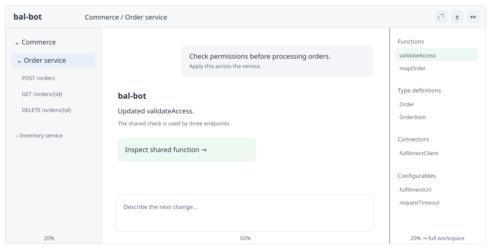
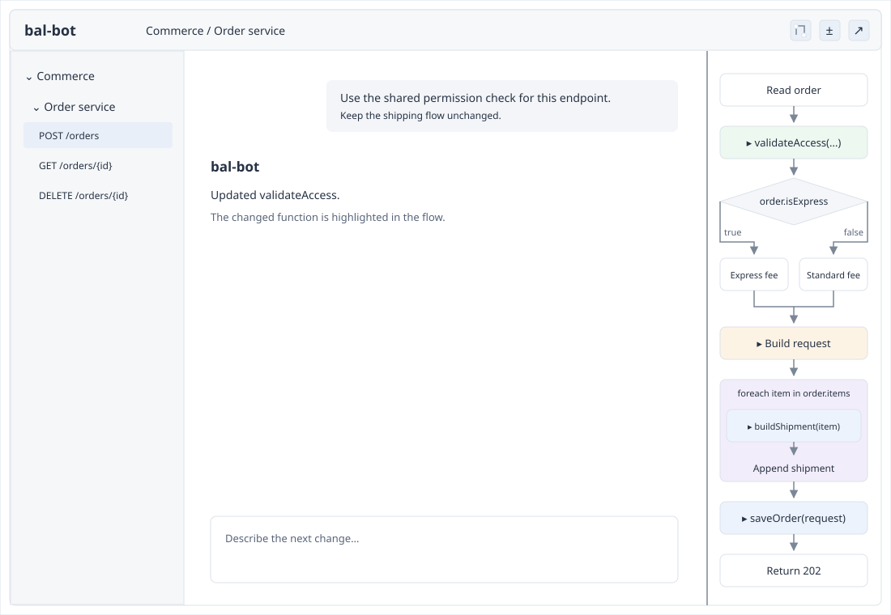
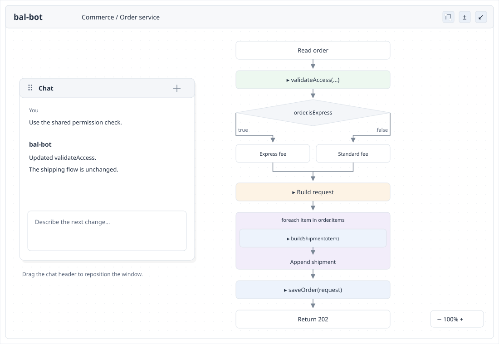
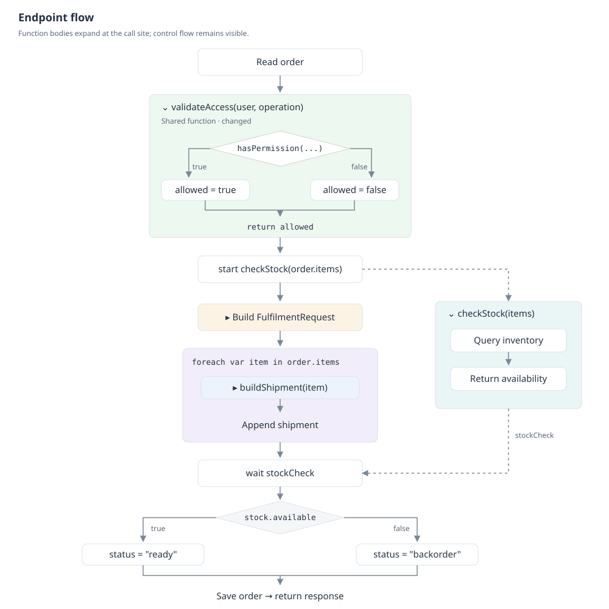
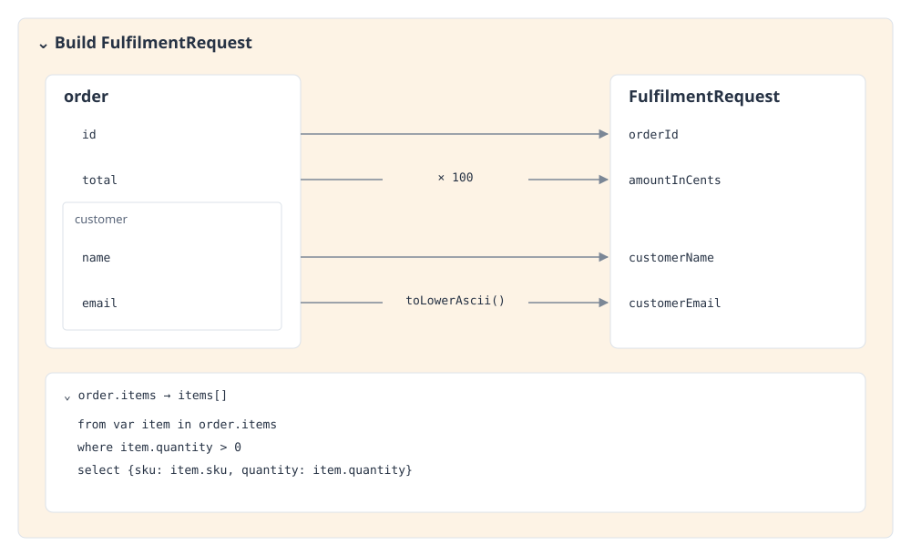

# UI overview

bal-bot is a web development environment for Ballerina services. Developers describe changes in chat and inspect the resulting code or flow.

## First-iteration scope

The source-flow implementation follows the layouts below with these exclusions: no manual zoom, diff/checkpoints/green changes, dedicated mapping expansion, async relationships, configurable discovery, or execution runtime. Flow scales down to fit the panel width with side margins; tall diagrams scroll vertically. Full-workspace expansion provides a larger view. Configurables are unsupported by the pinned Nutcracker version; runnable fixtures use supported features. Unsupported visualization effects keep exact source and an explicit limitation, with uncertain continuation edges omitted. Main functions appear as Automation when there are no services.

The remaining overview and images describe the longer-term UI where they include those deferred features.

## Workspace

- **Left, 20%:** projects → services → endpoints. The selected item identifies the working scope; do not repeat the endpoint name elsewhere.
- **Center, 60%:** chat. Each service and endpoint has its own agent and conversation. Selecting an item switches to its conversation; returning to it restores that conversation. The selected service or endpoint guides the agent's focus, while all agents can edit any file in the workspace.
- **Right, 20%:** flow or code diff. Small, right-aligned icons in the top bar switch views and expand/collapse the panel.

Expanded inspection fills the workspace below the top bar, taking over both the navigation and chat areas. Chat becomes a floating window that the developer can drag around the canvas. Collapsing inspection restores the 20/60/20 layout, preserving the conversation, selected scope, and expanded flow nodes.

At service scope, the right panel lists **functions, type definitions, connectors, and configurables**. Endpoints appear only in the left navigation. Omit redundant headings, explanatory labels, and status footers.

## Exploring an endpoint

**Normal view:** select an endpoint on the left; chat stays in the center and its flow appears on the right.

**Expanded view:** the same flow fills the workspace. Drag the floating chat by its header to move it out of the way. Collapse using the top-right control to restore the normal layout.

### Flow details

Selecting an endpoint shows its connected control-flow graph. Keep execution paths visible; reveal implementation details progressively.

- **Sequence:** solid arrows connect steps in execution order.
- **Condition:** show the expression, its branches, and their join when execution continues. Support early exits without assuming every branch terminates.
- **While:** show the condition expression, body, back edge, and exit.
- **Foreach:** show a container headed by the iteration binding and collection. Its body runs per item; execution leaves the container after iteration. No routine back arrow is needed. Explicit `continue` and `break` indicate next iteration and exit.
- **Function call:** click to expand the function's flow in place, preserving entry and exit connections. Shared functions remain one implementation; show affected callers in change details.
- **Client calls:** show the receiver and declared type, its source initializer when reliable, and the method with original arguments in source order. Use the same card for every client library. Long initializers expand independently of workspace method bodies. Parameter receivers say `Parameter`; mutable or unresolved origins do not display a guessed constructor.
- **Error operators:** `check` branches to `Return error`; `checkpanic` branches to `Panic with error`. A `trap` container captures panic paths from its operand as error values and rejoins normal evaluation. A checked failure inside `trap` still leaves the function. Enclosing on-fail constructs and conditional evaluation of these effects retain explicit unsupported-source regions.
- **String and XML templates:** show a shared source-text node with a fixed-width type column (`string` or `xml`) and a wrapping expression column, including backticks. XML is literal text, not rendered markup. The entire node selects the original complete template. Calls and error operators in interpolations participate in the surrounding evaluation, before template construction.
- **Async:** dotted arrows connect the launch to the asynchronous work and its result to the wait. Execution inside each path uses solid arrows. Identify the future without a “runs async” label.

Allow the graph to pan and zoom, and expand inspection to the full workspace for detailed exploration. Function and mapping expansion must preserve the surrounding flow.

## Data mappings

A mapping starts as one node. Click to expand its container:

- Group referenced source fields inside their record, retaining nested-record grouping.
- Connect source fields to fields in the target record. Put transformations on the arrows; direct assignments need no label.
- Expand function calls in place. Inputs to a multi-field expression converge before connecting to the target.
- Expand nested target records as mapping containers.
- For list queries, show the actual query expression. The projected record may optionally open as a record mapping. Preserve literals, calls, and other array expressions as written.

Arrows inside mappings describe data relationships; arrows between flow nodes describe execution.

## Reviewing changes

Use subtle, distinct container shades: functions blue, loops purple, mappings amber, and async sections teal. **Green highlights changed logic**, including collapsed containers with changes inside. Do not add add/remove markers to flow nodes.

Selecting changed logic reveals its change details and corresponding code diff. The diff uses green additions and red removals with `+`/`−` markers. Both views compare against the same checkpoint.
